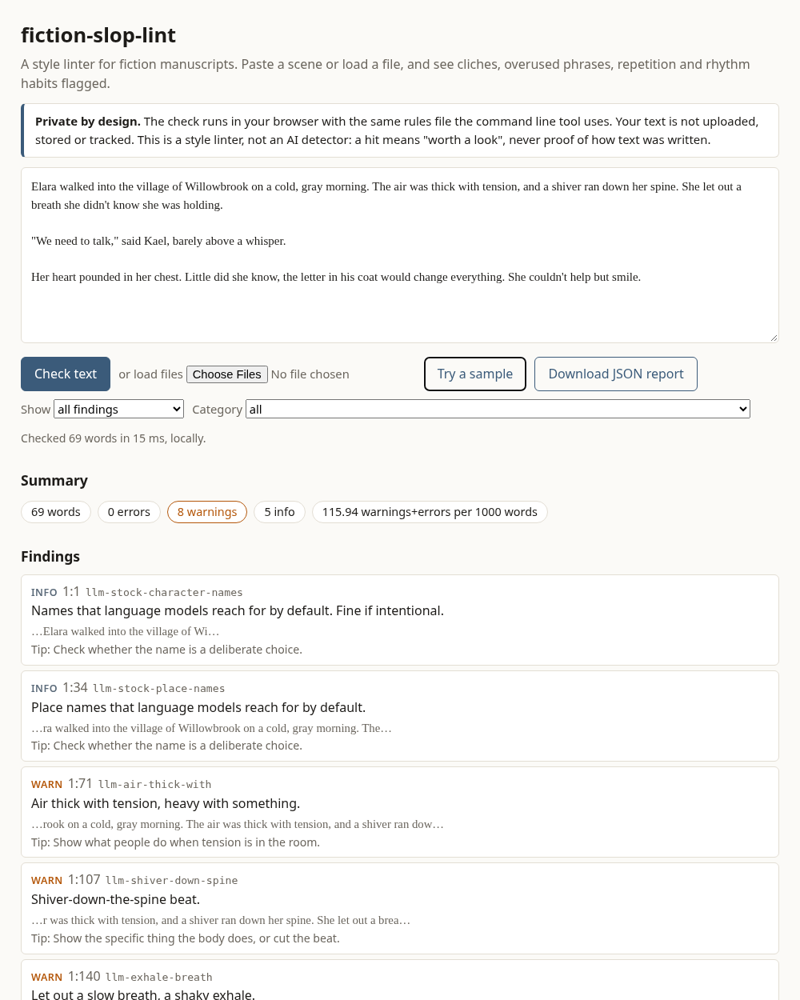

# fiction-slop-lint

[](LICENSE)

An offline **style linter for fiction manuscripts**. It scans Markdown, plain text or Word files and points at stock phrases, cliche beats, repeated phrases, and rhythm habits, with line numbers, like a code linter does for code.

- Python 3.9+, **standard library only**, one command: `fiction-slop-lint FILE...`
- **97 original rules** in one editable JSON file, not hidden in code
- Plain text report or `--json`, and `--strict` exit codes for scripts and CI
- A single-page **browser version** that runs locally with the same rules: **[try it](https://grades2018.github.io/fiction-slop-lint/)** (nothing is uploaded)
- A [`SKILL.md`](SKILL.md) so coding agents can run it on a manuscript folder



> **What this is not.** It is not an AI detector and makes no claim about who or what wrote a text. A finding means "this is a stock phrase or habit, worth a look". Human writers trigger these rules all the time, and plenty of weak prose triggers none.

## Why this exists

Stock phrases and tired beats make fiction feel generic whoever (or whatever) wrote them, and a plain offline checklist is a cheap way to catch them before an editor or reader does.

## Install

```
pip install git+https://github.com/grades2018/fiction-slop-lint
```

or from a clone:

```
git clone https://github.com/grades2018/fiction-slop-lint
cd fiction-slop-lint
pip install .
```

No clone needed to just try it: `python -m fiction_slop_lint FILE` works from the repo root, and the [web version](https://grades2018.github.io/fiction-slop-lint/) needs nothing at all.

## Usage

```
fiction-slop-lint chapter-01.md                 # one file
fiction-slop-lint manuscript/                   # folder: .md .txt .docx, natural sort order
fiction-slop-lint draft.docx --json > report.json
fiction-slop-lint manuscript/ --strict          # exit code 1 if thresholds are exceeded
cat scene.txt | fiction-slop-lint -             # stdin
```

| Option | Meaning |
|---|---|
| `--json` | machine readable report |
| `-v` | add context and a suggestion to every finding |
| `--strict` | exit 1 when any threshold below is exceeded |
| `--max-errors N` | strict: allowed errors (default 0) |
| `--max-warnings N` | strict: allowed warnings (default 25) |
| `--max-per-1000 X` | strict: allowed warnings plus errors per 1000 words (default 8.0) |
| `--min-severity info\|warn\|error` | hide softer findings |
| `--category A,B` / `--disable ID,ID` | run only some categories, or skip rules |
| `--exclude GLOB` | skip files when scanning folders |
| `--rules FILE` | use your own rules JSON |
| `--list-rules [--markdown]` | print all rules |

Exit codes: `0` ok, `1` strict thresholds exceeded, `2` usage or input error. Without `--strict` the exit code is `0` even when there are findings.

`.docx` files are read with `zipfile` and `xml.etree` from the standard library. Heading styles become chapter breaks. Only body text is read (no comments, footnotes or tracked deletions).

### Use in CI

`--strict` makes the tool usable as a style gate in any CI. A minimal GitHub Actions workflow, saved as `.github/workflows/style.yml` in a repo that keeps its manuscript in `manuscript/`:

```yaml
name: style
on: [push, pull_request]
jobs:
  lint:
    runs-on: ubuntu-latest
    steps:
      - uses: actions/checkout@v4
      - uses: actions/setup-python@v5
        with:
          python-version: "3.12"
      - run: pip install git+https://github.com/grades2018/fiction-slop-lint@v0.1.0
      - run: fiction-slop-lint manuscript/ --strict --max-warnings 25 --max-per-1000 8
```

Pinning a tag keeps results stable between runs. Use `@main` instead to pick up new rules as they land. The job fails only when a threshold is exceeded, so tune `--max-warnings` and `--max-per-1000` to your draft before making it required.

### Sample output

From `examples/01-cliche-heavy.md` (deliberately over-cliched text written for this repo):

```
fiction-slop-lint 0.1.0 - a style linter for fiction. Not an AI detector.

examples/01-cliche-heavy.md  (382 words, 35 sentences, 45 findings)
  5:83     warn  llm-air-thick-with                 Air thick with tension, heavy with something.
                                                   > The air was thick with
  5:119    warn  llm-shiver-down-spine              Shiver-down-the-spine beat.
                                                   > a shiver ran down
  ...
  13:69    warn  structure-not-x-but-y              3 occurrences, 7.9 per 1000 words (limit 1.5)
                                                   Frequent 'not X, but Y' or 'it wasn't X, it was Y' contrast pattern.
                                                   lines: 13, 19, 25
```

Full reports for three example texts are in [`examples/reports`](examples/reports): a cliche-heavy scene (many findings), a plain scene (none), and a three-chapter excerpt with repetition (repeated openers, a phrase that returns in every chapter).

## What it checks

97 rules in 9 categories. Every rule has an id, a severity (`info`, `warn`, `error`), a message and, for pattern rules, examples that the tests check. The complete table is in [`docs/RULES.md`](docs/RULES.md).

| Category | Rules | What it looks for |
|---|---|---|
| `llm-phrase` | 31 | Phrases and words that are everywhere in rushed or machine-written prose: "a testament to", "tapestry", "a shiver ran down", "little did she know", "barely above a whisper", the breath she did not know she was holding, "delve", tidy closing lines, default character and place names, and leftover chatbot text (`error`) |
| `body-cliche` | 18 | Stock body language: pounding hearts, clenched jaws, white knuckles, dropping stomachs, narrowing eyes, hands through hair, hanging silences |
| `simile-cliche` | 9 | Stock similes, dancing light and shadow, weather and wake-up openings |
| `dialogue` | 7 | Adverbs on tags, showy speech verbs, smiles used as tags, on-the-nose lines, density of `-ly` adverbs |
| `telling` | 9 | Filter words, hedging, named emotions, intensifiers, "suddenly", announced epiphanies, rule-of-three lists |
| `summary` | 6 | Summary where a scene could be: time skips, routines, backstory markers, memory floods, character labels |
| `structure` | 6 | Dash and ellipsis density, "not X, but Y" density, many `-ing` openers, reveal colons |
| `repetition` | 5 | Same sentence opener in a row, one opener word dominating, phrases repeated within or **across chapters and files**, very frequent names, echo words |
| `rhythm` | 6 | Monotone sentence or paragraph length, staccato streaks, very long sentences, many one-line paragraphs, paragraphs that all end on a punchline |

Three kinds of rule exist: `pattern` (flag every match), `density` (flag once when a pattern exceeds a per-1000-word limit, so a normal amount of em dashes is fine), and `metric` (a built-in measurement with parameters, such as sentence-length variation or n-gram repetition). All thresholds are in the JSON and are yours to change.

To add or change rules, edit [`fiction_slop_lint/data/rules.json`](fiction_slop_lint/data/rules.json) (see [CONTRIBUTING.md](CONTRIBUTING.md)), or pass your own file with `--rules`.

## Limitations and false positives

- **It will flag good writing.** A cliche can be right for a character, a genre can depend on its conventions, and deliberate repetition is a technique. Treat every finding as a question, not a verdict.
- **It is not an AI detector.** There is no score that says "written by AI". Text with zero findings can still be machine-written, and text full of findings can be entirely human. Do not use it to judge authors.
- **Thresholds are judgment calls.** As a calibration point at v0.1.0, a full public-domain novel (Pride and Prejudice, about 131,000 words) produced 50 warnings, roughly 0.4 per 1000 words, while the cliche-heavy sample produces about 81 per 1000. Your genre will sit somewhere else; adjust the JSON.
- **English only.** Patterns are English phrases. Sentence splitting is a heuristic (it handles common abbreviations and dialogue punctuation, not everything).
- **First-person and dialogue-heavy text** naturally trips opener, name and short-sentence rules.
- **Regex matching** means inflections and rewordings slip through, and some patterns match more than intended. Please [report false positives](https://github.com/grades2018/fiction-slop-lint/issues/new/choose).
- **Word files:** body text only, and line numbers refer to the extracted text. The browser version reads text and Markdown files, not `.docx`.
- **Publishing note:** Amazon KDP requires authors to disclose AI-generated text when they publish. This tool does not change that obligation and is not a way around it. Check KDP's current content guidelines for the exact rules.

## Development

```
python -m unittest discover -s tests -t .
```

The tests cover the rules file (every pattern rule must match its own examples), the engine, the CLI, `.docx` reading, and a parity test that runs the browser engine (`docs/slop.js`) under Node and checks it produces the same findings as the Python engine. After editing the rules run `python tools/sync_rules.py` to refresh `docs/rules.json`.

Layout: `fiction_slop_lint/` (package and `data/rules.json`), `docs/` (GitHub Pages site, same rules), `examples/`, `tests/`, `SKILL.md`.

## License

[MIT](LICENSE).

---

<sub>Built by the team behind [ImagineYourBook](https://www.imagineyourbook.com/). Want a full first draft? ImagineYourBook drafts complete manuscripts. This tool works on any author's text and has no connection to that service.</sub>
